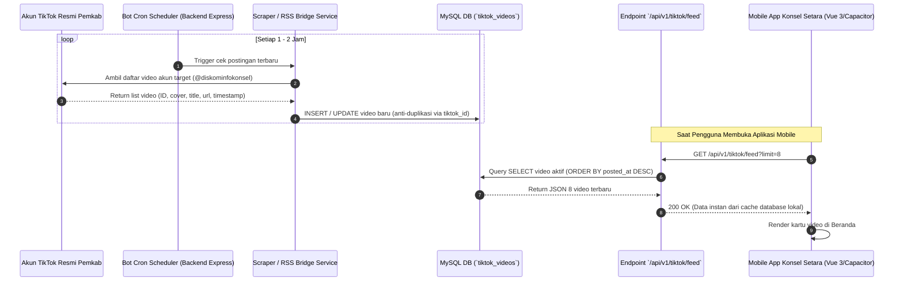

# 📱 Rencana Implementasi: Integrasi Feed Video TikTok Otomatis (Skenario B)
**Proyek: Konsel Setara (Pemerintah Kabupaten Konawe Selatan)**

> **Status: dibatalkan / tidak digunakan.** Pada 17 Oktober 2026 diputuskan bahwa pengisian video TikTok tetap dilakukan manual melalui panel admin. Scheduler, fungsi sinkronisasi semu, dan endpoint `/api/v1/tiktok/sync` telah dihapus. Dokumen ini dipertahankan hanya sebagai arsip rencana lama dan bukan gambaran sistem yang aktif.

Dokumen ini adalah rencana kerja komprehensif (*implementation plan*) untuk mengintegrasikan feed video dari akun TikTok resmi Pemerintah Daerah (misal: Diskominfo / Pemkab Konawe Selatan) ke dalam aplikasi mobile **Konsel Setara** secara otomatis dan berkala tanpa campur tangan manual operator.

---

## 🎯 1. Tujuan & Sasaran Fitur

1. **Otomatisasi Penuh**: Setiap kali akun TikTok resmi Pemkab mengunggah video baru, aplikasi mobile Konsel Setara secara otomatis memperbarui daftar videonya dalam interval waktu tertentu (1–2 jam).
2. **Pengalaman Pengguna Interaktif**: Menyajikan kartu video modern (thumbnail cover asli, durasi, judul konten, dan badge TikTok) di halaman beranda ([IndexPage.vue](file:///Users/simplephi/Documents/riswan/konsel-setara/frontend/src/pages/IndexPage.vue)).
3. **Deep-linking Cepat**: Ketika pengguna mengklik kartu video, aplikasi langsung membuka video tersebut di aplikasi TikTok smartphone mereka (atau in-app webview jika tidak memiliki aplikasi TikTok).
4. **Ketahanan Sistem (*Resilience & Fallback*)**: Menggunakan database lokal sebagai *cache* agar aplikasi mobile tetap cepat dan tidak terpengaruh jika TikTok sedang mengalami *rate-limit* atau gangguan jaringan.

---

## 🏗️ 2. Arsitektur & Alur Kerja Sistem (Skenario B)



---

## 🗄️ 3. Perancangan Database MySQL (`konsel_setara`)

Dibuat tabel baru bernama `tiktok_videos` dan tabel konfigurasi `tiktok_config`:

### 1. Tabel: `tiktok_accounts` (Manajemen Multi-Akun)
```sql
CREATE TABLE IF NOT EXISTS `tiktok_accounts` (
  `id` INT AUTO_INCREMENT PRIMARY KEY,
  `username` VARCHAR(100) NOT NULL UNIQUE COMMENT 'Username TikTok (tanpa @)',
  `display_name` VARCHAR(100) NOT NULL COMMENT 'Label nama akun (misal: Diskominfo Resmi / Konsel Daily)',
  `category` ENUM('official', 'daily') NOT NULL DEFAULT 'official' COMMENT 'official = Berita/Kebijakan Formal, daily = Human Interest/Vlog/Santai',
  `badge_color` VARCHAR(30) DEFAULT 'blue' COMMENT 'Warna badge UI (misal: blue, amber, green)',
  `avatar_url` VARCHAR(500) COMMENT 'URL avatar profil TikTok',
  `is_active` TINYINT(1) DEFAULT 1 COMMENT '1 = Aktif dipantau & tampil, 0 = Nonaktif',
  `last_sync_at` DATETIME NULL COMMENT 'Waktu sinkronisasi terakhir',
  `created_at` DATETIME DEFAULT CURRENT_TIMESTAMP
) ENGINE=InnoDB DEFAULT CHARSET=utf8mb4 COLLATE=utf8mb4_unicode_ci;

-- Data Awal: 2 Akun Diskominfo Konsel
INSERT INTO `tiktok_accounts` (`username`, `display_name`, `category`, `badge_color`) VALUES
('diskominfokonsel', 'Diskominfo Resmi', 'official', 'blue'),
('dailykonsel', 'Konsel Daily', 'daily', 'amber');
```

### 2. Tabel: `tiktok_videos`
```sql
CREATE TABLE IF NOT EXISTS `tiktok_videos` (
  `id` INT AUTO_INCREMENT PRIMARY KEY,
  `tiktok_id` VARCHAR(64) NOT NULL UNIQUE COMMENT 'ID unik postingan dari TikTok',
  `account_id` INT NOT NULL COMMENT 'ID akun asal (relasi ke tiktok_accounts)',
  `author_username` VARCHAR(100) NOT NULL COMMENT 'Username akun pembuat',
  `category` ENUM('official', 'daily') NOT NULL DEFAULT 'official',
  `title` TEXT COMMENT 'Caption atau deskripsi video',
  `video_url` VARCHAR(500) NOT NULL COMMENT 'URL langsung ke halaman web postingan TikTok',
  `play_url` VARCHAR(1000) COMMENT 'Direct link stream MP4 untuk pemutaran langsung di dalam aplikasi (in-app)',
  `cover_url` VARCHAR(500) COMMENT 'URL gambar thumbnail cover video',
  `play_count` BIGINT DEFAULT 0 COMMENT 'Jumlah tayangan video',
  `digg_count` INT DEFAULT 0 COMMENT 'Jumlah suka (likes)',
  `comment_count` INT DEFAULT 0 COMMENT 'Jumlah komentar',
  `posted_at` DATETIME NOT NULL COMMENT 'Waktu video diunggah di TikTok',
  `is_active` TINYINT(1) DEFAULT 1 COMMENT '1 = Tampil di aplikasi, 0 = Disembunyikan',
  `created_at` DATETIME DEFAULT CURRENT_TIMESTAMP,
  `updated_at` DATETIME DEFAULT CURRENT_TIMESTAMP ON UPDATE CURRENT_TIMESTAMP,
  FOREIGN KEY (`account_id`) REFERENCES `tiktok_accounts`(`id`) ON DELETE CASCADE,
  INDEX `idx_posted_active` (`is_active`, `category`, `posted_at` DESC)
) ENGINE=InnoDB DEFAULT CHARSET=utf8mb4 COLLATE=utf8mb4_unicode_ci;

---

## 🛠️ 4. Spesifikasi Modul Backend (`backend/`)

### 1. Struktur File Modul Baru:
```
backend/
├── apiMysql/
│   └── tiktok.js              # Endpoint router Express untuk TikTok
├── services/
│   └── tiktokScraper.js       # Logika ekstraksi metadata TikTok & anti-rate limit
├── jobs/
│   └── tiktokSyncJob.js       # Penjadwal cron (node-cron)
└── index.js                   # Mendaftarkan rute & inisialisasi job
```

### 2. Metode Ekstraksi Data (*Scraper Service*):
TikTok memiliki proteksi bot, sehingga digunakan kombinasi metode ekstraksi yang stabil:
- **Metode Primer**: Menggunakan library parser profil publik TikTok / reverse API TikWM (`https://tikwm.com/api/user/posts?unique_id=...`) yang menyediakan data JSON profil publik secara legal dan bebas CORS.
- **Metode Sekunder (*Fallback*)**: RSSHub bridge publik / oEmbed resolver jika API primer mengalami *rate-limit*.

### 3. Daftar Endpoint API Backend:

| Method | Endpoint | Akses | Fungsi |
| :--- | :--- | :---: | :--- |
| `GET` | `/api/v1/tiktok/feed` | Publik | Mengambil daftar video aktif untuk mobile (mendukung query `?limit=8`). |
| `POST` | `/api/v1/tiktok/sync` | Admin / Token | Menjalankan sinkronisasi paksa (*manual sync*) sekarang juga. |
| `GET` | `/api/v1/tiktok/config` | Admin | Membaca pengaturan username akun target. |
| `PUT` | `/api/v1/tiktok/config` | Admin | Mengubah username target akun TikTok tanpa restart server. |
| `PATCH`| `/api/v1/tiktok/toggle/:id` | Admin | Mengaktifkan/menyembunyikan video tertentu dari feed mobile. |

---

## 📱 5. Spesifikasi Tampilan di Mobile (`frontend/`)

Perubahan pada [frontend/src/pages/IndexPage.vue](file:///Users/simplephi/Documents/riswan/konsel-setara/frontend/src/pages/IndexPage.vue):

1. **Komponen Strip Video Beranda**:
   - **Tab Pill Filter Kategori**: Di atas strip video, terdapat filter tombol kapsul:
     `[🔥 Semua Video]` `[🏛️ Akun Resmi]` `[🎬 Konsel Daily]`
     Pengguna dapat berganti tab secara instan tanpa reload halaman.
   - **Kartu Video Vertikal**: Rasio kartu vertikal modern (`aspect-ratio: 9/16` atau `130px x 210px`).
   - **Badge Penanda Akun**: Di pojok kiri atas thumbnail, terdapat pill badge kecil:
     - Badge Biru: *"Resmi"*
     - Badge Oranye/Kuning: *"Daily"*
   - **Statistik & Caption**: Jumlah *views* / *likes* di pojok kanan bawah, dan judul/caption maksimal 2 baris (*line clamp*).

2. **Interaksi Pengguna (In-App Video Playback - Tanpa Keluar Aplikasi)**:
   - **Ketuk Kartu Video**:
     - Membuka modal/dialog pemutar video modern (**In-App Shorts / Reels Modal Player**) langsung di dalam aplikasi Konsel Setara.
     - Menggunakan HTML5 `<video controls autoplay playsinline loop>` dengan sumber stream langsung `play_url` (MP4 tanpa watermark) atau TikTok Official Embed (`iframe`).
     - Pengguna bisa:
       - Memutar, menghentikan (*play/pause*), dan mengatur suara langsung di aplikasi.
       - Membaca deskripsi/caption lengkap dan tanggal posting.
       - Menekan tombol tutup (✖) untuk kembali ke beranda seketika tanpa *reload*.
       - Terdapat tombol opsional *"Buka di TikTok"* hanya jika pengguna ingin memberikan komentar atau follow akun resmi.
   - **Tombol "Video Lainnya" / Header**:
     - Menampilkan dialog aksi dengan opsi:
       - 🎵 Buka Profil TikTok Resmi Pemkab Konsel
       - 📺 Buka Kanal YouTube Resmi Pemkab Konsel

3. **Status Pemuatan (*Skeleton & Error State*)**:
   - Tampilkan shimmer skeleton 4 kartu vertikal selama request API awal.
   - Jika offline atau data kosong, tampilkan *fallback cache* terakhir dari `localStorage`.

---

## 🖥️ 6. Spesifikasi Web Admin (`admin/`)

Di Web Admin Dashboard, disiapkan modul sederhana di sidebar:
* **Halaman**: **Integrasi Video TikTok** (`/settings/tiktok` atau `/media/tiktok`).
* **Fitur**:
  1. **Status Sinkronisasi Terakhir**: Menampilkan waktu sinkronisasi otomatis terakhir dan jumlah video yang tersimpan.
  2. **Tombol "Sinkronkan Sekarang"**: Memudahkan admin memicu pengambilan video secara manual jika baru saja mengunggah video penting di TikTok.
  3. **Input Akun Target**: Form untuk mengubah username TikTok resmi Pemkab jika terjadi pergantian akun.
  4. **Daftar Video & Switch Moderasi**: Admin bisa menonaktifkan (*toggle off*) video tertentu jika tidak relevan ditampilkan di aplikasi Konsel Setara.

---

## 📋 7. Tahapan Eksekusi & Checklist Kerja

```
[ ] FASE 1: PERSIAPAN DATABASE & SERVICE BACKEND
    [ ] Buat migration tabel `tiktok_videos` dan `tiktok_config` di database MySQL `konsel_setara`.
    [ ] Buat service ekstraktor `services/tiktokScraper.js` untuk mengambil post akun target.
    [ ] Pasang cron scheduler berkala menggunakan `node-cron` di `backend/jobs/tiktokSyncJob.js`.

[ ] FASE 2: IMPLEMENTASI ENDPOINT API
    [ ] Buat endpoint publik `GET /api/v1/tiktok/feed`.
    [ ] Buat endpoint admin `POST /api/v1/tiktok/sync` dan `PUT /api/v1/tiktok/config`.
    [ ] Daftarkan router di `backend/index.js` dan update dokumentasi OpenAPI / Swagger.

[ ] FASE 3: INTEGRASI FRONTEND MOBILE ANDROID
    [ ] Tambahkan service API di `frontend/src/api/apiTiktok.js`.
    [ ] Hubungkan feed `IndexPage.vue` ke endpoint `/api/v1/tiktok/feed`.
    [ ] Poles kartu video vertikal dengan thumbnail TikTok, badge, dan title clamp.
    [ ] Implementasi deep-linking ke aplikasi TikTok Android.

[ ] FASE 4: INTEGRASI WEB ADMIN DASHBOARD
    [ ] Tambahkan modul manajemen TikTok di sidebar Admin.
    [ ] Buat tombol trigger sinkronisasi dan form konfigurasi akun.
    [ ] Pengujian menyeluruh (manual test & cron test).
```

---

## 🛡️ 8. Catatan Keamanan & Stabilitas

1. **CORS & Rate Limit**: Semua request ke TikTok dilakukan melalui server backend, bukan langsung dari browser/HP pengguna. Hal ini mencegah masalah CORS dan memblokir kebocoran kuota request.
2. **Cache First Architecture**: Frontend mobile hanya membaca database lokal MySQL `konsel_setara`, sehingga waktu respon API sangat cepat (< 50ms) dan aplikasi mobile tidak akan pernah *hang* meskipun TikTok sedang down.
3. **Penyaringan Konten**: Hanya video dari akun resmi yang terdaftar di konfigurasi yang akan diproses ke dalam database.
